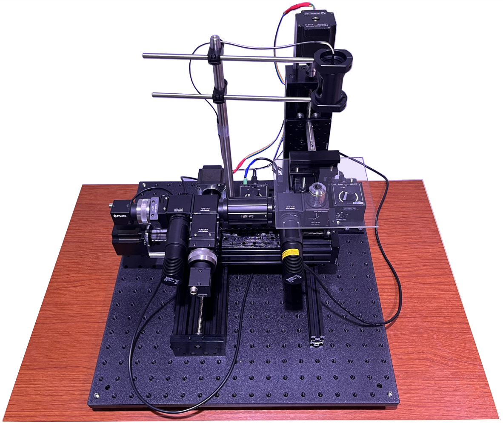
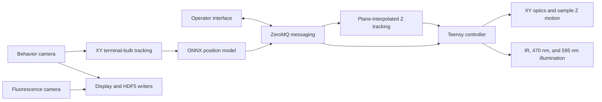
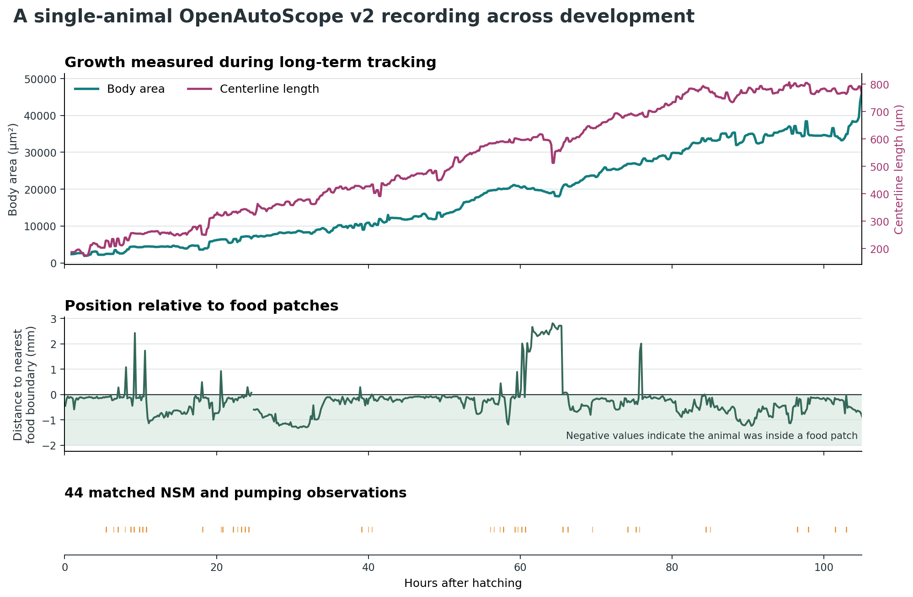
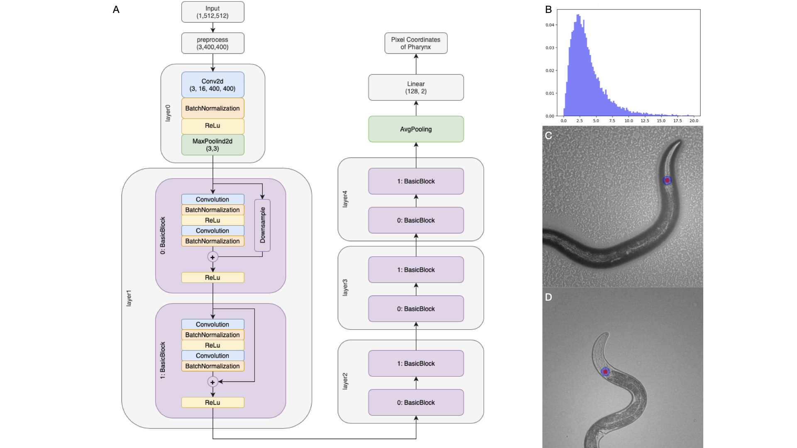
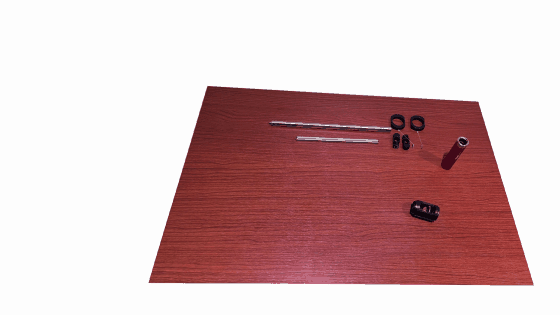

# OpenAutoScope v2

**A compact microscope for long-term behavioral recording and calcium imaging in freely moving *C. elegans*.**

  

OpenAutoScope v2 combines transmitted-light behavioral imaging, wide-field fluorescence imaging, XY and Z tracking, and optogenetic illumination. It was designed to follow one animal over long experiments: XY tracking keeps the terminal bulb near the center of the image, while Z tracking adjusts focus as the animal moves. The recordings can be used to examine calcium-dependent fluorescence and pharyngeal pumping alongside behavior, position, and development.

The repository includes the deployed control software, trained tracking models, PCB manufacturing files, a parts list, and practical build and operating documentation.

## Capabilities

| Capability | Implementation |
| --- | --- |
| XY tracking | Closed-loop optical-stage control driven by real-time terminal-bulb localization |
| Z tracking | Sample-holder Z position interpolated from three sample-surface reference points, with an adjustable offset |
| Two-camera acquisition | Separate behavior and fluorescence cameras with independent exposure settings |
| Fluorescence imaging | 470 nm excitation and a GFP-channel imaging path for indicators such as GCaMP |
| Optogenetic stimulation | Separate 595 nm illumination path |
| Behavioral measures | Transmitted-light images, stage position, morphology, and position relative to food patches |
| Distributed acquisition | ZeroMQ-connected camera, tracker, controller, writer, logger, and Teensy processes |

## How It Works

Two FLIR cameras acquire behavior and fluorescence images. An ONNX model estimates the terminal-bulb position from behavior frames; its output feeds the controller that moves the XY optical stage. The image streams are displayed and written independently, while a Teensy controls stage motion and illumination.

See the [system overview](documentation/system-overview.md) and [software architecture](documentation/software-architecture.md) for the verified hardware and process layout.

## Long-Term Imaging Showcase

The example below comes from one unpublished recording collected and analyzed by Sina Rasouli; the lab approved display of the derived plots. It contains 44 discrete observations with matched NSM fluorescence and pharyngeal-pumping data, spanning 97.6 hours between the first and last observation. Processed behavioral data also describe body morphology and position relative to food patches over time.

The strain identifier is intentionally omitted. These observations do not imply uninterrupted fluorescence imaging. Raw data are not stored in this repository.

The [data showcase](documentation/data-showcase.md) presents a matched NSM and pumping observation, kymographs across development, processing details, and data provenance.

## Neural-Network Tracking

The tracking model localizes the terminal bulb to guide XY stage motion. Mahdi Torkashvand collected and manually annotated the initial approximately 17,000 behavior frames. Mahdi and Sina Rasouli collaborated on later dataset expansion and augmentation; Sina led model training, integration into the control software, and later system modifications.

  

The current repository contains several ONNX models for different magnifications and imaging conditions. The [tracking documentation](documentation/tracking.md) distinguishes the initial manual dataset from later model-specific training corpora recorded in [`models.json`](models.json).

## Build and Operate

The animation is a condensed preview of the project assembly video. Detailed build and operating resources are available through the [documentation index](documentation/README.md):

- [Parts list](parts/parts.pdf)
- [PCB manufacturing files](pcb/README.md)
- [Software installation](documentation/installation.md)
- [Calibration](documentation/calibration.md)
- [Graphical interface](documentation/gui.md)
- [Example imaging session](documentation/imaging_session.md)

## Project History and Contributions

OpenAutoScope v2 was initiated and led by Mahdi Torkashvand, including system design, assembly, control-software development, and creation of the initial training datasets. Sina Rasouli contributed to assembly and software development and led the machine-learning work, including model training and integration. After Mahdi left the lab in 2025, Sina led further system modifications, data collection, and analysis.

See [project history and contributions](documentation/project-history.md) for the full attribution statement and the provenance of the showcase dataset.

## Repository Status

- The deployed environment targets Windows and requires the FLIR Spinnaker SDK and attached hardware.
- Camera serial numbers, ports, model selection, and motion parameters are installation-specific.
- The repository contains inference models but not a complete reproducible model-training pipeline.
- No hardware-independent automated test suite is provided.

## License

The repository software is available under the [MIT License](LICENSE). Project media and the unpublished-data figures have separate reuse terms described in [media attribution](documentation/media-attribution.md).
