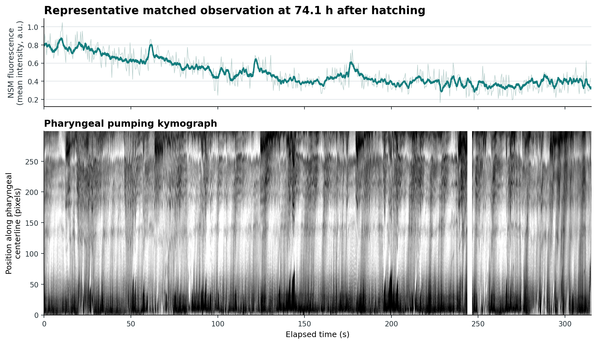
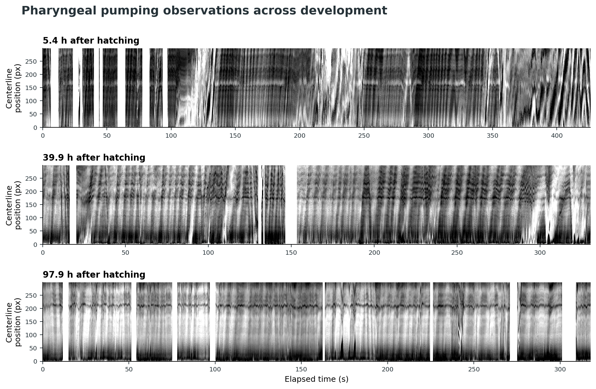

# Long-Term Data Showcase

This page presents derived results from one unpublished OpenAutoScope v2 recording. The Venkatachalam Lab approved public display of these plots. Sina Rasouli collected and analyzed the dataset; the documentation figures were rendered from Sina's processed outputs.

The strain identifier is intentionally omitted. Fluorescence is described as NSM activity without publishing the strain name.

## Dataset Scope

The processed behavior record contains 2,052,578 timestamps spanning approximately 112 hours. Within that record, 44 discrete observations contain matched NSM fluorescence and pharyngeal-pumping data. The first and last matched observations are approximately 97.6 hours apart.

The 44 observations are discrete sessions. They do not represent uninterrupted fluorescence acquisition throughout the experiment.

## Developmental Overview

The upper panel summarizes body area and centerline length after hatching. The middle panel shows signed distance to the nearest of 18 mapped food patches; negative values indicate that the tracked position was inside a patch. The lower panel marks the 44 matched NSM and pumping observations.

Processing used for this documentation figure:

- Non-finite and non-positive morphology values were excluded.
- Intervals marked as tracking loss, with a ten-frame buffer, were excluded.
- Morphology and food-distance values were summarized in ten-minute median bins.
- Isolated morphology bins differing by more than 18 percent from a local 70-minute median were replaced by that local median, followed by a three-bin median filter.
- Observation timing was calculated from the recorded behavior timestamps relative to the recorded hatching timestamp.

These steps make developmental trends easier to see while limiting the effect of isolated segmentation errors.

## Matched NSM and Pumping Observation

This example begins 74.1 hours after the recorded hatching time. The NSM trace is the mean fluorescence across each processed 500-sample profile, with a one-second moving average overlaid. The kymograph shows processed intensity along the pharyngeal centerline. Missing kymograph values were not interpolated.

The trace is shown in arbitrary fluorescence units. It shows changes within this observation; the values are not calibrated for comparison between experiments.

## Pumping Across Development

The three observations begin 5.4, 39.9, and 97.9 hours after hatching. Each panel uses its own second-to-98th-percentile intensity range so that pumping structure remains visible despite changes in brightness and animal size. Blank vertical regions correspond to missing values in the processed kymograph and were not filled.

## Data Availability

The raw and processed dataset is not committed to this repository. It is large, contains unpublished material, and remains under laboratory stewardship. The repository stores only the lab-approved derived figures needed to document the system's capabilities.

## Provenance

| Contribution | Person |
| --- | --- |
| Instrument design, primary assembly, control-software design and development, initial tracking-data collection, and initial manual annotations | Mahdi Torkashvand |
| Tracking-model training and integration, later system modifications, collection of this dataset, and data analysis | Sina Rasouli |
| Permission to display derived plots | Venkatachalam Lab |

See [Project History and Contributions](project-history.md) for the broader project record and [Media Attribution](media-attribution.md) for figure reuse terms.
