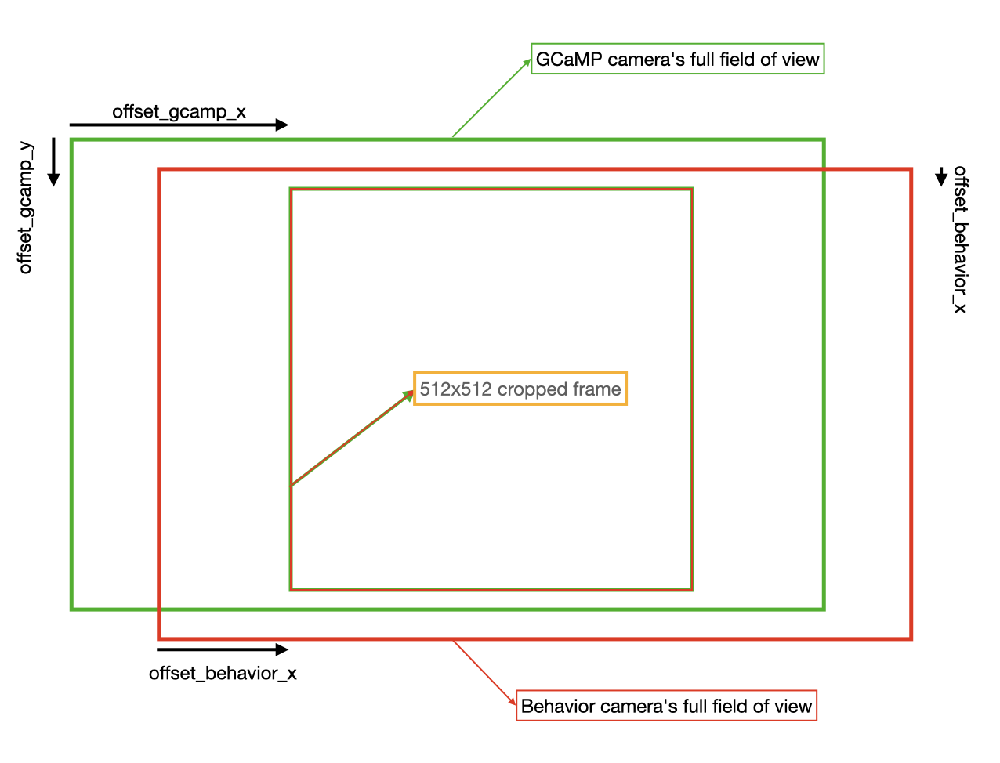

# Parameters

This page summarizes the parameters used to assemble, calibrate, and operate OpenAutoScope v2.

### Camera Serial Numbers
The system uses separate cameras for transmitted-light behavioral imaging and GFP-channel fluorescence imaging. The behavior path uses far-red or near-infrared illumination; the fluorescence path uses 470 nm excitation. The 595 nm optogenetic illumination has a separate light path. Each camera's serial number appears on its label and in the SpinView `Devices` panel. Record both serial numbers in the [configuration](../configs.json) file.

### Camera Offset Values
The cameras used in this system have a sensor size of 1920 by 1200. To optimize signal quality and reduce file size, we implement a resolution reduction by a factor of 2 and utilize a bin size of two. As a result, the full field of view frame size becomes 960 by 600. However, due to the inherent imperfections of the system's components and the assembly process, there may be offsets in both the x and y directions between the two cameras, despite them receiving signals from the same objective. To ensure perfectly aligned frames, we use a cropped version of the frames. Specifically, from the original 960 by 600 field of view, we crop a 512 by 512 frame. By adjusting the location of these crops, we achieve the desired alignment of frames. The following drawing shows how the full field of view and the offset parameters are related.

  

### Imaging Frame Rate (`framerate`)
The frame rate parameter determines the speed at which both cameras capture images. When you initiate the system, the cameras operate at the default frame rate value. However, you have the option to modify this value within the [graphical user interface (GUI)](gui.md). If needed, you can also adjust the default value within the [configuration file](../configs.json). It is worth noting that the frame rate directly impacts the available processing time for online tasks like object detection, which is crucial for tracking. Therefore, it is advisable to run the system at the lowest frame rate that meets the requirements of your specific experiments.

### Exposure Time (`exposure_gcamp`, `exposure_behavior`)
The exposure time for each camera determines how long the camera sensors collect incoming light. Although both cameras operate at the same frame rate, they have different durations for light capture. It is recommended to use lower frame rates to allow sufficient time for online processing tasks. However, it is essential to limit the exposure time to prevent camera saturation. If small features in bright areas of the images are disappearing or becoming difficult to discern due to high light intensity, it is advisable to decrease the exposure time. The exposure time for each camera can be adjusted within the [graphical user interface (GUI)](gui.md), and the default values can also be modified in the [configuration file](../configs.json).

### Tracking Model
The tracking system uses a customized ResNet18 variant. [`models.json`](../models.json) maps each model-selection key to a trained model and its settings. The corresponding keys appear in the [graphical user interface](gui.md), where the operator can select a model suited to the imaging conditions and developmental stage.

### Background Subtraction Quantile
The left display in the [graphical user interface](gui.md) shows an overlay of both channels, with the behavior channel in gray and the GCaMP channel in green. Background subtraction is applied to the green channel to reduce its baseline hue. The `q` parameter sets the subtraction quantile; its default is `0.7`. Set `q` to `0` in the [configuration file](../configs.json) to display the raw channel overlay without background subtraction.

### X, Y, and Z Speed
The [Xbox controller](xbox_controller.md) and [graphical interface](gui.md) provide manual motion controls. XY motion moves the optical assembly; Z motion moves the sample holder. The [configuration file](../configs.json) contains default XY (`xypad-input`) and Z (`zpad-input`) speed settings, which can also be changed in the graphical interface.
