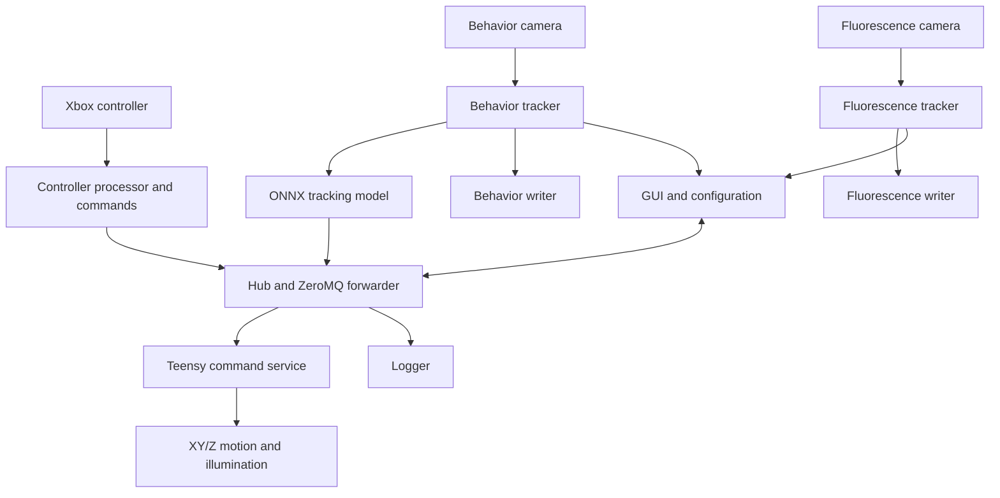

# Software Architecture

OpenAutoScope v2 uses a distributed process architecture. The graphical interface starts and supervises independent services for cameras, tracking, model inference, motion commands, logging, and writing. ZeroMQ carries commands, status, and control messages; image data travel over dedicated array streams.

## Runtime Topology

[`openautoscopev2/system/oas.py`](../openautoscopev2/system/oas.py) launches these processes:

| Process | Responsibility |
| --- | --- |
| Hub and forwarder | Route commands, status messages, and client requests |
| Controller processor and commands | Convert operator input into system commands |
| Behavior camera | Acquire the image stream used for visual tracking |
| Fluorescence camera | Acquire the GFP-channel image stream |
| Behavior tracker | Crop, display, forward, and prepare behavior frames for inference |
| Fluorescence tracker | Apply the matching display and recording geometry to fluorescence frames |
| Tracking-model service | Run the selected ONNX model and publish target coordinates |
| Teensy command service | Translate control messages into optical-stage, sample-Z, and illumination actions |
| Writers | Save behavior and fluorescence streams independently |
| Logger | Record system state and experiment messages |

## Closed-Loop Tracking

The behavior tracker sends image data to the model service. The selected model returns terminal-bulb coordinates, which are compared with the desired image position. The resulting correction enters the command path and moves the XY optical stage. Separately, the software can calculate sample-holder Z position from an interpolated plane and adjustable offset.

The tracking model is one component in the stage-control loop; its output does not directly drive hardware. See [Neural-Network Tracking](tracking.md) for the training-data and contribution history.

## Configuration

[`configs.json`](../configs.json) contains installation-specific values such as camera serial numbers, Teensy port, image format, exposure times, frame rate, crop offsets, tracking mode, and motion settings. [`models.json`](../models.json) maps runtime model choices to ONNX files and records model-specific notes.

These files describe the deployed system. Values should be verified during [installation](installation.md) and [calibration](calibration.md), not copied blindly to another build.

## Platform Dependencies

The current installation procedure targets Windows and requires the FLIR Spinnaker SDK, a Python environment, and Teensy support in the Arduino toolchain. The repository packages inference models and runtime software but does not provide a hardware simulator or an automated end-to-end test environment.
