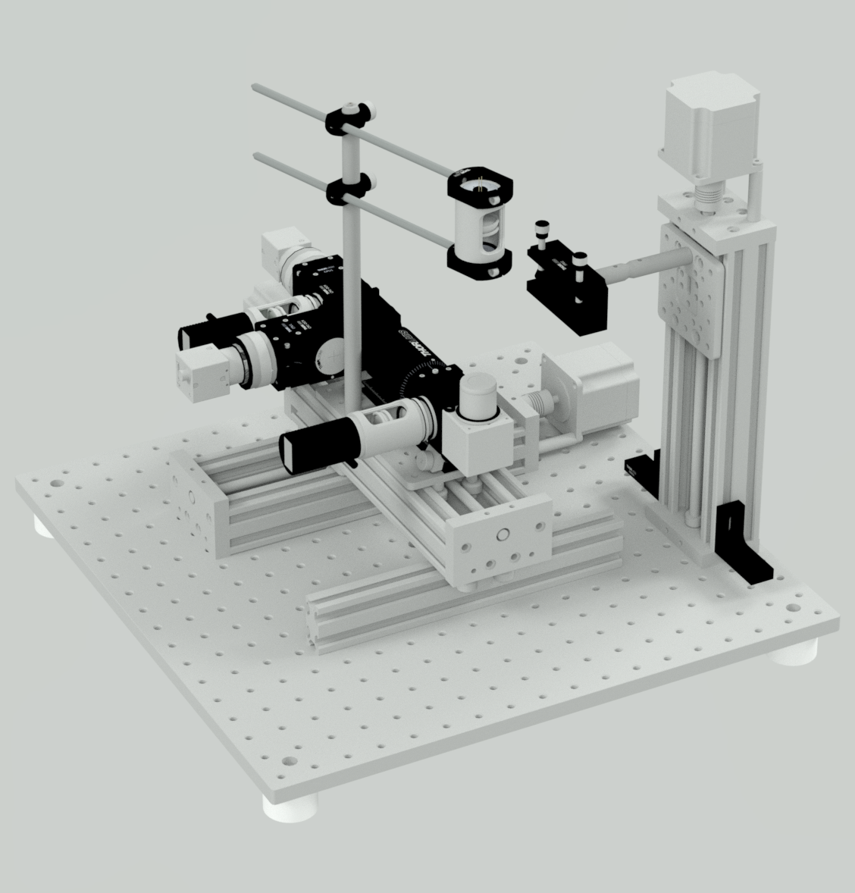
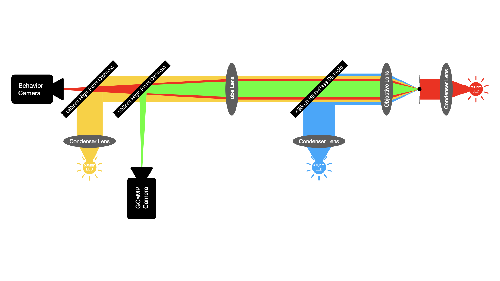

# System Overview

OpenAutoScope v2 is a compact microscope for long-term behavioral recording and wide-field fluorescence imaging of a freely moving *C. elegans*. It combines separate behavior and fluorescence cameras, motorized stage motion, neural-network tracking, and an optogenetic illumination path.

## Design Goals

- Follow an animal over experiments lasting many hours or days.
- Record behavior and fluorescence through separate cameras.
- Keep a selected anatomical landmark centered through closed-loop stage motion.
- Adjust Z position as the animal moves across the sample surface.
- Control fluorescence excitation and optogenetic illumination independently.
- Store image data and device state without coupling recording to the user interface.
- Use commercially available components and repository-provided mechanical, PCB, and software resources.

## Physical Layout

  
  

The optical assembly moves in XY, while the sample holder moves in Z. The software calculates a Z position from three reference points on the sample surface and an adjustable offset. Adjustable tube-lens and camera positions bring the behavior and fluorescence paths into focus together.

## Optical Paths

  

| Path | Purpose |
| --- | --- |
| Far-red / near-infrared transmitted light | Behavioral imaging without using the fluorescence or stimulation channels |
| 470 nm | Excitation for GFP-channel fluorescence imaging |
| 595 nm | Wide-field optogenetic illumination |

The two camera streams have independent exposure settings. Their alignment and cropping offsets are configured during [calibration](calibration.md).

## Motion and Control Hardware

The XY optical stage keeps the terminal bulb near the center of the behavior image. The tracking estimate is converted into motion commands and sent to a Teensy controller, which also controls illumination. Manual stage positioning is available through an Xbox controller.

## Data Products

An imaging session can produce behavior and fluorescence image streams, timestamps, stage position, device logs, and tracking state. Downstream analysis can measure body morphology, position relative to food, GCaMP fluorescence, and pharyngeal pumping. An approved example is presented in the [long-term data showcase](data-showcase.md).

## Build Resources

- [Parts list](../parts/parts.pdf)
- [PCB files and ordering notes](../pcb/README.md)
- [Assembly preview](../images/showcase/assembly-preview.gif)
- [Installation](installation.md)
- [Calibration](calibration.md)

Component substitutions can change optical spacing, load limits, electrical requirements, or calibration. Review modifications with the current instrument maintainers before applying them to the deployed system.
